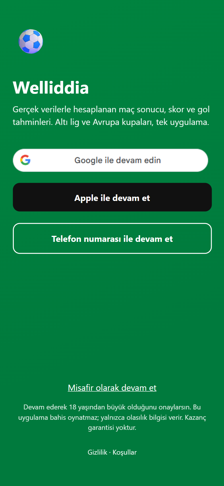
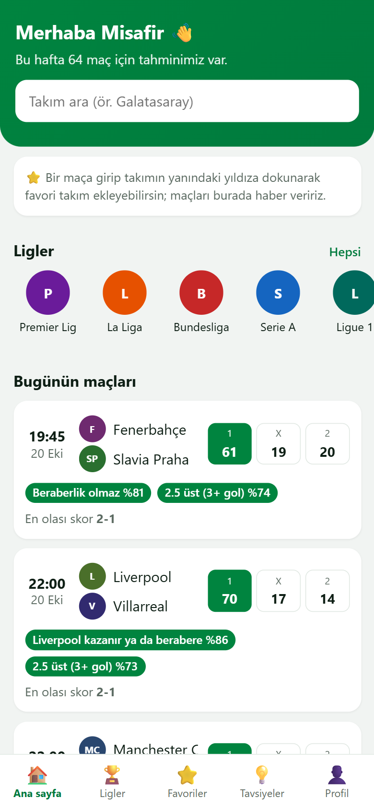
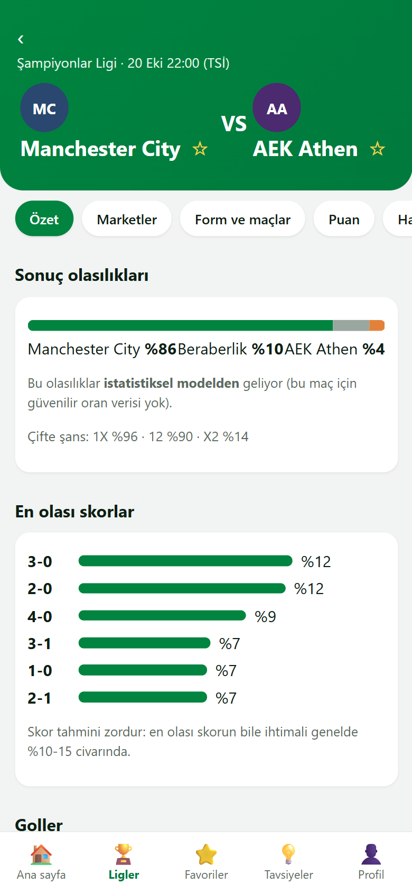

# Welliddia: football match probabilities, benchmarked and scored in public

[](https://github.com/Weli-byte/Ma-analizi/actions/workflows/ci.yml)


A research platform that turns football data into **calibrated 1X2 probabilities** (plus goals, both-teams-to-score and
score distributions), compares many model families on the same footing, and then **scores its own published forecasts
against the real results**. A mobile-first web app and a REST API sit on top.

**Live demo:** https://mac-tahmin-eight.vercel.app (Turkish UI with an English switch; guest sign-in works)

| Sign-in | Today's matches | Match page |
|---|---|---|
|  |  |  |

> **This is not betting advice and the app places no bets.** Forecasts are statistical estimates, they guarantee nothing,
> and the app is for adults (18+). See the in-app privacy and terms pages (`/gizlilik`, `/kosullar`; drafts, not legal advice).

## How well does it work? (honest numbers)

Published forecasts are locked before kickoff and scored after the match, on every finished match. Current read, **259 matches
between 9 October and 31 October 2026** (track record of 1 November 2026; about four weeks, so treat it as a first look, not a verdict):

| Prediction | Hit rate | 95% interval | Naive baseline |
|---|---|---|---|
| 1X2 (most likely result) | 163/259 = **62.9%** | 56.9% to 68.6% | "always home": 50.2% |
| Over/under 2.5 goals | 159/259 = 61.4% | 55.3% to 67.1% | "always over": **63.3%** |
| Both teams to score | 143/259 = 55.2% | 49.1% to 61.1% | "always yes": **57.5%** |
| Exact score | 22/259 = 8.5% | 5.7% to 12.5% | |

Probability quality (Log Loss, lower is better): 1X2 league base rate 1.036, model alone 0.910, published forecast 0.896
(market on the 221 matches with exact odds 0.879). Over 2.5: 0.659 vs 0.682 for the 2020-23 base rate; BTTS: 0.691 vs 0.684.
What that means, stated plainly:

- The model clearly beats a no-information baseline on 1X2 and over/under, so it carries real signal; on an untouched past
  season (2023-24, 1,752 matches) the same holds ([sprint 17 report](docs/phase3/sprint17_report.md)).
- **Both-teams-to-score is not better than its base rate** (slightly worse live, not demonstrated on 2023-24).
- **The model alone is slightly worse than the bookmaker market**, in line with the project's earlier backtests (no model beat
  the market). The published 1X2 forecast is driven by exact-timestamp market odds where they exist, so its closeness to the
  market is expected and is **not** evidence of an edge.
- Hit rates of "always over" / "always yes" are higher than the model's picks; log loss is the fairer score for probabilities.
- Confidence buckets are validated: the 40 % most confident forecasts hit 80.0 % live (85 matches) and 66.4 % on 2023-24
  ([sprint 16 report](docs/phase3/sprint16_report.md)); the least confident fifth is marked "abstain" and shows no value suggestion.
- No single competition has 50 or more matches; per-competition rates are noise.

An earlier write-up of the first 130 matches (same conclusions on 1X2):
[`reports/model_comparison_2026-10-19.md`](reports/model_comparison_2026-10-19.md). The live site shows the current record at
`/basari-kaydi`, per competition.

## What is inside

- **Data and leakage control.** Chronological and walk-forward evaluation only, never a random split. Nothing after a
  forecast's `information_cutoff` can enter a feature; final-test seasons are technically locked
  ([leakage policy](docs/leakage_policy.md), [benchmark protocol](docs/benchmark_protocol.md)).
- **Models.** Elo, Poisson / Dixon-Coles, XGBoost, LightGBM (Optuna), a walk-forward engine, an LLM probability benchmark
  (OpenAI, Anthropic, Google adapters, strict JSON, forward-only guard), calibration (temperature scaling, reliability), and
  out-of-fold ensembles. Metrics: Log Loss, Brier, RPS, ECE; accuracy is secondary and there is no single "winner".
- **Live engine.** Fixture snapshots at t-24h, t-90m, t-30m and kickoff (immutable, content-hashed), an in-play Poisson
  model, and live-result ingestion. Missing information stays `UNKNOWN`; nothing is imputed.
- **Match intelligence.** Scores, goals, corners, cards, referee, top scorers and injuries (information only, never in a
  probability), for six leagues (the big five and the Turkish Süper Lig) and the UEFA club cups.
- **Web app and API.** Mobile-first web UI, favourites, search, Google sign-in, Free/Pro plan infrastructure (gates off, nothing
  is sold), and a FastAPI `/v1` with API keys, rate limits and an OpenAPI schema.
- **Operations.** Hourly cloud jobs refresh forecasts and redeploy the site (`/v1/health` names the deployed commit); a daily job
  keeps lock files fresh with one rolling PR. Runbooks in [`docs/`](docs/).
- **Research hardening (Phases 2 and 3).** Real xG and line-up observations kept as-of and behind data gates, odds-aware ensembles,
  goal-market label audit, out-of-fold calibration selection, a prospective record with immutable hashes, prediction lineage
  ("Tahmin künyesi"), drift and data-quality monitoring with Telegram alerts, frozen stage records (t-24h / t-90m / t-30m / kickoff),
  uncertainty and selective prediction ("Model güveni"), a pre-registered ablation laboratory with a promotion gate, and production
  hardening: provider circuit breaker, hourly SLOs with an error budget, canary policy, release gate, recorded restore and rollback
  drills ([`docs/phase3/`](docs/phase3/)).

## Engineering rules this repo enforces

- Every artifact carries a content-derived `data_version`; loaders fail loudly on stale artifacts.
- Predictions are immutable and content-hashed; a changed prediction is a new snapshot, and the ledger rejects conflicts.
- Missing values are `NaN` plus an availability flag and reason, never a silent 0. xG is not available and is never faked.
- Only exact-timestamp odds may drive edge/EV/CLV; closing odds are a reference baseline. Value analytics are suggestions
  only (ADR 0039).
- TLS verification is never disabled; no secrets in code; CI is only called green when GitHub Actions actually ran green.
- Methodological changes need an ADR ([`docs/adr/`](docs/adr/), 90+ decisions); golden artifacts change only with an ADR.
- Experiments are pre-registered: the spec's hash is committed before its result, and an experiment has one result only.

Working rules for contributors and agents: [`CLAUDE.md`](CLAUDE.md).

## Quick start

Python **3.12** or **3.14**. Dependencies come from `pyproject.toml`; `requirements.lock` is a hash-pinned universal lock.

```bash
python -m venv .venv
source .venv/bin/activate                # Windows: .venv\Scripts\activate
pip install --require-hashes -r requirements.lock
pip install --no-deps -e .
ruff check . && pytest                   # 1,300+ tests: golden, reproducibility, leakage, provenance, web, API
```

Run the research pipeline:

```bash
python -m src.data.pipeline --mode strict          # atomic, content-versioned dataset
python -m src.features.builder --mode strict
python -m src.evaluation.run_baselines --mode strict
python -m src.evaluation.walk_forward --mode strict
python -m src.markets.track                        # score published forecasts against real results
```

Run the web app and API locally:

```bash
uvicorn src.api.app:create_app --factory --port 8000    # the web UI is served at /, the API at /v1
```

Regenerating the lock after a dependency change needs `--upgrade`
(see [`CLAUDE.md`](CLAUDE.md)):
`uv pip compile pyproject.toml --extra dev --universal --generate-hashes --python-version 3.12 --upgrade -o requirements.lock`

## Layout

`src/` (`data`, `features`, `models`, `evaluation`, `llm`, `ingestion`, `snapshot`, `live`, `odds`, `markets`, `mlops`,
`dashboard`, `api`, `web`, `league_models`, `xg`, `availability`, `oddsens`, `goalmkts`, `calibsel`, `prospective`, `lineage`,
`drift`, `stages`, `uncertainty`, `experiments`, `release`) · `configs/` · `data/` · `docs/` (guides, `adr/`, data-source licensing) · `tests/` (with golden
fixtures and real provider captures) · `reports/` · `scripts/` · `.github/workflows/`

## Data sources and licensing

The code is MIT-licensed ([LICENSE](LICENSE)). **The data is not**: every source is currently `RESEARCH_ONLY`
([`docs/data_sources/licensing.md`](docs/data_sources/licensing.md)): football-data.org (free tier), openfootball
(public domain, results and fixtures), The Odds API (odds), API-Football (injuries, free plan) and others. Resolve the
terms of each provider before any commercial use. Club logos are off by default (trademarks).

## Status

Sprints S0 to S18, the league-model programme, Phase 2 (sprints 7 to 12) and Phase 3 (sprints 13 to 18) are built. The release
gate says CONDITIONAL_GO for the research product and NO_GO for a commercial launch (licences); live service objectives are on
`/durum`, the operations handbook is [`docs/phase3/sprint18_operations.md`](docs/phase3/sprint18_operations.md). The remaining S19 items (paid sign-in providers, payments,
Highlightly PRO, paid odds, a custom domain) need money or an account the owner does not have yet. Details and the decision log are in [`CLAUDE.md`](CLAUDE.md) and
[`docs/adr/`](docs/adr/).

## Author

Built by Veli Parlak ([veliparlak84@gmail.com](mailto:veliparlak84@gmail.com)), Türkiye.
