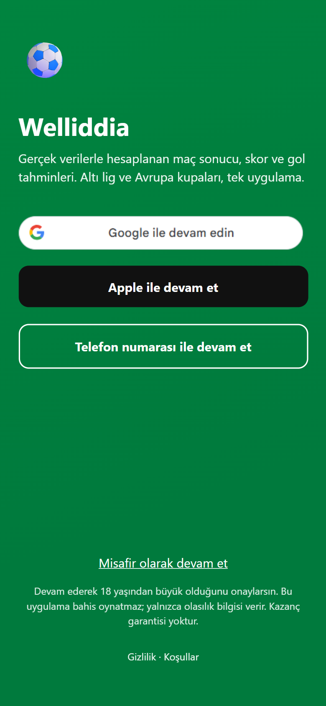
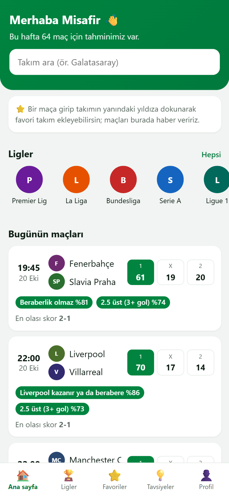
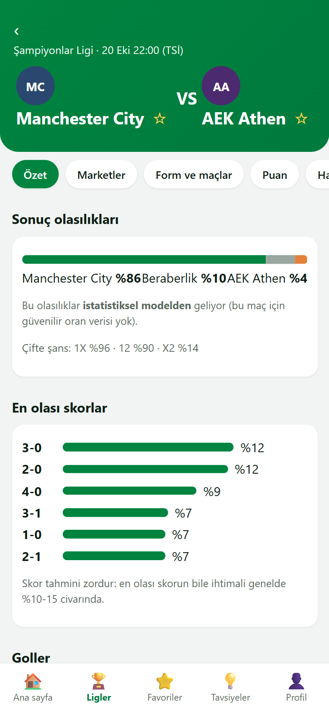

# Welliddia: football match probabilities, benchmarked and scored in public

[](https://github.com/Weli-byte/Ma-analizi/actions/workflows/ci.yml)


A research platform that turns football data into **calibrated 1X2 probabilities** (plus goals, both-teams-to-score and
score distributions), compares many model families on the same footing, and then **scores its own published forecasts
against the real results**. A mobile-first web app and a REST API sit on top.

**Live demo:** https://mac-tahmin-eight.vercel.app (Turkish UI with an English switch; guest sign-in works)

| Sign-in | Today's matches | Match page |
|---|---|---|
|  |  |  |

> **This is not betting advice and the app places no bets.** Forecasts are statistical estimates, they guarantee nothing,
> and the app is for adults (18+). See the in-app privacy and terms pages (`/gizlilik`, `/kosullar`; drafts, not legal advice).

## How well does it work? (honest numbers)

Published forecasts are locked before kickoff and scored after the match, on every finished match. First read, **138 matches
between 9 and 19 October 2026** (generated 20 October 2026; the record is short, so treat it as a first look, not a verdict):

| Prediction | Hit rate | 95% interval | Naive baseline |
|---|---|---|---|
| 1X2 (most likely result) | 94/138 = **68.1%** | 59.9% to 75.3% | "always home": 52.9% |
| Over/under 2.5 goals | 84/138 = 60.9% | 52.5% to 68.6% | "always over": **68.8%** |
| Both teams to score | 76/138 = 55.1% | 46.7% to 63.1% | |
| Exact score | 10/138 = 7.2% | 4.0% to 12.8% | |

Probability quality on 1X2 (Log Loss, lower is better): league base rate 1.023, model alone 0.874, market 0.853,
published forecast 0.851. What that means, stated plainly:

- The model clearly beats a no-information baseline, so it carries real signal.
- **The model alone is slightly worse than the bookmaker market**, in line with the project's earlier backtests
  (no model beat the market).
- The published 1X2 forecast is driven by exact-timestamp market odds in nearly every match, so its closeness to the market
  is expected and is **not** evidence of an edge.
- For over/under, "always over" scored higher than the model in this sample.
- No single competition has 20 or more matches; per-competition rates are noise.

An earlier write-up of the first 130 matches (same conclusions):
[`reports/model_comparison_2026-10-19.md`](reports/model_comparison_2026-10-19.md). The live site shows the current record at
`/basari-kaydi`, per competition.

## What is inside

- **Data and leakage control.** Chronological and walk-forward evaluation only, never a random split. Nothing after a
  forecast's `information_cutoff` can enter a feature; final-test seasons are technically locked
  ([leakage policy](docs/leakage_policy.md), [benchmark protocol](docs/benchmark_protocol.md)).
- **Models.** Elo, Poisson / Dixon-Coles, XGBoost, LightGBM (Optuna), a walk-forward engine, an LLM probability benchmark
  (OpenAI, Anthropic, Google adapters, strict JSON, forward-only guard), calibration (temperature scaling, reliability), and
  out-of-fold ensembles. Metrics: Log Loss, Brier, RPS, ECE; accuracy is secondary and there is no single "winner".
- **Live engine.** Fixture snapshots at t-24h, t-90m, t-30m and kickoff (immutable, content-hashed), an in-play Poisson
  model, and live-result ingestion. Missing information stays `UNKNOWN`; nothing is imputed.
- **Match intelligence.** Scores, goals, corners, cards, referee, top scorers and injuries (information only, never in a
  probability), for six leagues (the big five and the Turkish Süper Lig) and the UEFA club cups.
- **Web app and API.** Mobile-first web UI, favourites, search, Google sign-in, Free/Pro plan infrastructure (gates off, nothing
  is sold), and a FastAPI `/v1` with API keys, rate limits and an OpenAPI schema.
- **Operations.** Scheduled cloud jobs refresh data and redeploy the site; a daily job keeps lock files fresh with one rolling
  PR. Runbooks in [`docs/`](docs/).

## Engineering rules this repo enforces

- Every artifact carries a content-derived `data_version`; loaders fail loudly on stale artifacts.
- Predictions are immutable and content-hashed; a changed prediction is a new snapshot, and the ledger rejects conflicts.
- Missing values are `NaN` plus an availability flag and reason, never a silent 0. xG is not available and is never faked.
- Only exact-timestamp odds may drive edge/EV/CLV; closing odds are a reference baseline. Value analytics are suggestions
  only (ADR 0039).
- TLS verification is never disabled; no secrets in code; CI is only called green when GitHub Actions actually ran green.
- Methodological changes need an ADR ([`docs/adr/`](docs/adr/), 60+ decisions); golden artifacts change only with an ADR.

Working rules for contributors and agents: [`CLAUDE.md`](CLAUDE.md).

## Quick start

Python **3.12** or **3.14**. Dependencies come from `pyproject.toml`; `requirements.lock` is a hash-pinned universal lock.

```bash
python -m venv .venv
source .venv/bin/activate                # Windows: .venv\Scripts\activate
pip install --require-hashes -r requirements.lock
pip install --no-deps -e .
ruff check . && pytest                   # ~900 tests: golden, reproducibility, leakage, provenance, web, API
```

Run the research pipeline:

```bash
python -m src.data.pipeline --mode strict          # atomic, content-versioned dataset
python -m src.features.builder --mode strict
python -m src.evaluation.run_baselines --mode strict
python -m src.evaluation.walk_forward --mode strict
python -m src.markets.track                        # score published forecasts against real results
```

Run the web app and API locally:

```bash
uvicorn src.api.app:create_app --factory --port 8000    # the web UI is served at /, the API at /v1
```

Regenerating the lock after a dependency change needs `--upgrade`
(see [`CLAUDE.md`](CLAUDE.md)):
`uv pip compile pyproject.toml --extra dev --universal --generate-hashes --python-version 3.12 --upgrade -o requirements.lock`

## Layout

`src/` (`data`, `features`, `models`, `evaluation`, `llm`, `ingestion`, `snapshot`, `live`, `odds`, `markets`, `mlops`,
`dashboard`, `api`, `web`) · `configs/` · `data/` · `docs/` (guides, `adr/`, data-source licensing) · `tests/` (with golden
fixtures and real provider captures) · `reports/` · `scripts/` · `.github/workflows/`

## Data sources and licensing

The code is MIT-licensed ([LICENSE](LICENSE)). **The data is not**: every source is currently `RESEARCH_ONLY`
([`docs/data_sources/licensing.md`](docs/data_sources/licensing.md)): football-data.org (free tier), openfootball
(public domain, results and fixtures), The Odds API (odds), API-Football (injuries, free plan) and others. Resolve the
terms of each provider before any commercial use. Club logos are off by default (trademarks).

## Status

Sprints S0 to S18 are built; the remaining S19 items (paid sign-in providers, payments, Highlightly PRO, a custom domain) need
money or an account the owner does not have yet. Details and the decision log are in [`CLAUDE.md`](CLAUDE.md) and
[`docs/adr/`](docs/adr/).

## Author

Built by Veli Parlak ([veliparlak84@gmail.com](mailto:veliparlak84@gmail.com)), Türkiye.
